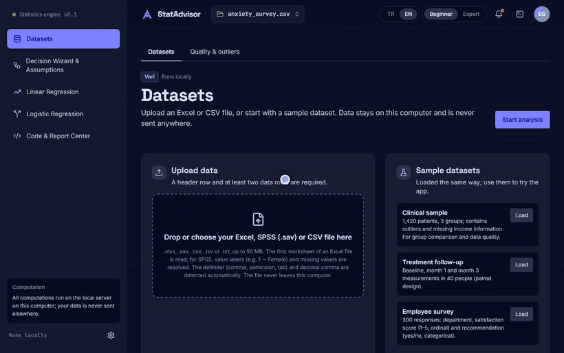
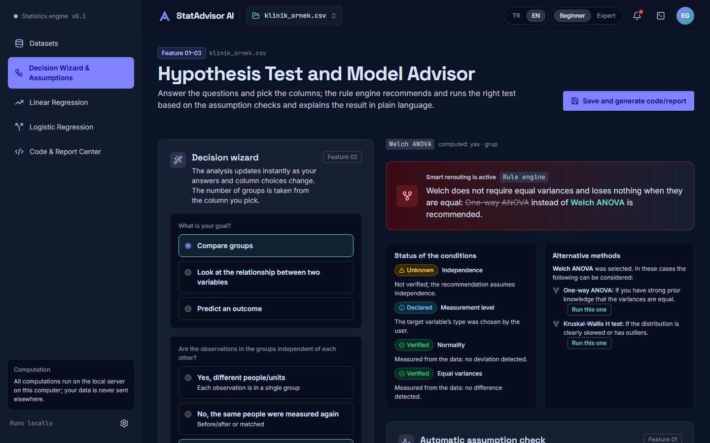
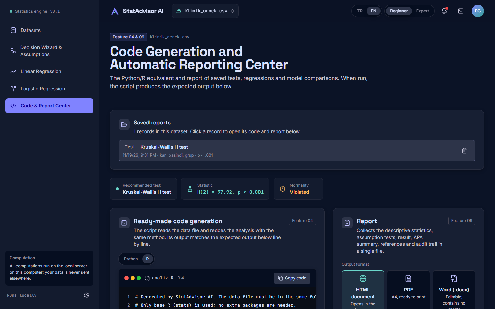
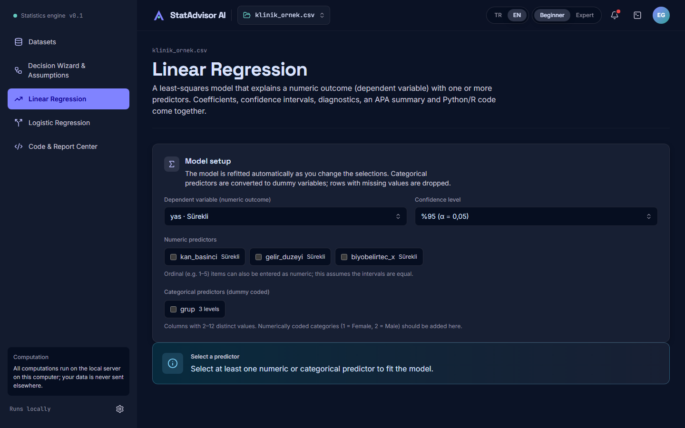

# StatAdvisor

[](https://github.com/erenguzelw/statadvisor/actions/workflows/ci.yml) [](LICENSE)

**English** · [Türkçe](#türkçe)



<sub>Scale score with item analysis (a weak item is flagged) → the Decision Wizard checks the assumptions and recommends Welch's t-test → the R script that reproduces the result. Regenerate with `node tools/readme-demo.mjs`.</sub>

## English

A local, privacy-first **survey data analysis assistant**. Upload your data (Excel `.xlsx`, SPSS `.sav` or CSV); the app checks data quality, tests the assumptions, **recommends the right statistical test (and explains why)**, runs it and interprets the result in plain language. It also fits linear and logistic regression, builds Likert scale scores with Cronbach's alpha and an item analysis that flags weak or miscoded items, screens careless responses, and generates **reproducible Python and R code** whose output matches the on-screen numbers line by line, plus HTML / PDF / DOCX reports. **Everything runs on your computer; your data never leaves it.**

The interface and all generated interpretations, reports and code comments are available in **English and Turkish** (toggle in the top bar).



| Generated R code with English comments | Regression report |
|---|---|
|  |  |

### Highlights

| Area | What it does |
|---|---|
| **Data** | CSV / Excel / SPSS import with value labels; column-type inference, data-quality audit, cleaning with an audit trail, scale scores (reverse items, Cronbach's α, item analysis: corrected item-total r and α if item deleted), straight-lining and Mahalanobis response screening. |
| **Decision Wizard** | Recommends a test from your goal, design and variables; normality and equal variances are computed from the data, and the reason is shown whenever the recommendation changes (e.g. Student t → Welch → Mann-Whitney). Alternatives can be run with one click. |
| **Tests** | Student/Welch t, Mann-Whitney U, one-way and Welch ANOVA (Tukey HSD / Games–Howell), Kruskal-Wallis (Dunn), paired t, Wilcoxon, sign test, repeated-measures ANOVA, Friedman, Pearson, Spearman, Kendall tau-b, chi-square, Fisher exact, McNemar, Cochran Q. |
| **Regression** | Linear and binary logistic regression with confidence intervals, diagnostics (VIF, Cook, Durbin–Watson, Hosmer–Lemeshow, AUC) and an APA summary. |
| **Code & reports** | Python **and R** scripts for every analysis (base R only, no extra packages). Both are executed in automated tests and compared with the on-screen result. |

### Why you can trust the numbers

- The statistics engine is validated against **1,568 reference cases** produced with SciPy / statsmodels / scikit-learn / pingouin.
- Generated **Python** code is run against the same data and its console output must equal the app's output line by line.
- Generated **R** code (R 4.4, base R only) is held to the same standard: 34 tests execute the scripts with `Rscript` and compare every printed line with the app (hypothesis tests, post-hoc tests, scale scores, screening, linear/logistic regression, data cleaning including a package-free KNN imputer).
- Translation-coverage tests run representative analyses and fail if Turkish text slips through into the English output (analysis text, regression and logistic narratives, HTML/DOCX reports, generated code comments).

### Quick start

```bash
npm install
npm start            # builds the UI and serves it at http://127.0.0.1:3001
npm run dev          # development: API on 3001, UI on http://localhost:5173
npm run check        # type check + lint + all unit tests
npm run e2e          # Playwright end-to-end and accessibility tests
```

Requirements: Node.js 24+ (developed on Node 26). Optional: `npx playwright install chromium` for PDF reports; Python and R are needed only to run the code-verification tests (they are skipped when absent).

### Tech stack

TypeScript everywhere · React + Tailwind + Vite · Fastify + SQLite (`node:sqlite`) · Vitest · Playwright · a custom statistics engine in `packages/shared` (no heavy numeric dependencies).

### Architecture

- `packages/shared`: statistics engine, decision rules, regression, data cleaning, scale scores, code generation (Python and R), reports and the translation core (`src/i18n`).
- `apps/api`: Fastify server with SQLite. Listens on `127.0.0.1` only and checks Host/Origin headers.
- `apps/web`: React interface (`src/i18n` holds the language layer).

### Limitations

The ML "model comparison" and factorial ANOVA pages are hidden from the menu (the survey focus); robust (HC) standard errors and Firth logistic regression are not implemented; repeated-measures ANOVA has no Greenhouse-Geisser correction; multivariate methods (MANOVA, factor analysis) are not included. Verify citations before publishing and have a statistician review important analyses.

---

## Türkçe

> Sayfanın başındaki demo (İngilizce arayüz): ölçek puanı ve madde analizi (zayıf madde işaretlenir) → karar sihirbazı varsayımlara bakıp Welch t-testini önerir → sonucu yeniden üreten R betiği.

Anket verileri için **yerel çalışan** bir veri analizi asistanı. Verinizi (Excel `.xlsx`, SPSS `.sav` ya da CSV) yükleyin; uygulama veri kalitesini denetler, varsayımlara bakıp **doğru istatistiksel testi önerir** (nedenini açıklar), hesaplar ve sade bir dille yorumlar. Doğrusal ve lojistik regresyon kurar, Likert ölçek puanı ve Cronbach alfa hesaplar, madde analiziyle zayıf ya da yanlış kodlanmış maddeleri işaretler, dikkatsiz yanıtları tarar; ekrandaki sayıları birebir yeniden üreten **Python ve R kodunu** ve raporu (HTML, PDF, DOCX) üretir. **Her şey bu bilgisayarda çalışır; veriniz dışarı gönderilmez.** Arayüz, yorumlar, raporlar ve kod açıklamaları **Türkçe ve İngilizce** olarak sunulur (üst çubuktaki TR/EN düğmesi).

Proje önce yalnızca bir "hipotez testi danışmanı" olarak başladı; sonra anket analizine odaklanan bir analiz asistanına dönüştü.

### Neler yapar?

| Alan | İçerik |
|---|---|
| **Veri** | CSV / Excel (.xlsx) / SPSS (.sav) yükleme; sütun türü tanıma, veri kalitesi denetimi, temizleme, ölçek puanı (ters madde, Cronbach alfa, madde analizi: düzeltilmiş madde-toplam r ve madde silinirse alfa), yanıt taraması. SPSS'te değer etiketleri (ör. 1 → Kadın), kullanıcı eksikleri ve tarihler çözülür. |
| **Karar Sihirbazı** | Amaç, tasarım ve sütun seçimine göre test önerisi; normallik ve varyans eşitliği veriden hesaplanır; öneri değişirse nedeni yazılır. Önerinin alternatifleri "Bunu çalıştır" ile denenebilir. |
| **Testler** | Student/Welch t, Mann-Whitney U, tek yönlü ve Welch ANOVA (Tukey HSD / Games–Howell), Kruskal-Wallis (Dunn), eşleştirilmiş t, Wilcoxon, işaret testi, tekrarlı ölçümler ANOVA, Friedman, Pearson, Spearman, Kendall tau-b, ki-kare, Fisher kesin testi, McNemar, Cochran Q. |
| **Regresyon** | Doğrusal ve ikili lojistik regresyon: katsayılar, güven aralıkları, tanılar (VIF, Cook, Durbin–Watson…), APA özeti. |
| **Kod ve rapor** | Her analizin **Python ve R** karşılığı (çıktısı ekrandakiyle birebir aynıdır, testle doğrulanır; R için yalnızca temel R yeter) ve HTML / DOCX / PDF raporu; Kod & Rapor Merkezi'nde saklanır. |
| **Gizli sayfalar** | Faktöriyel ANOVA (`/faktoriyel-anova`) ve model karşılaştırma (`/model-karsilastirma`) menüden kaldırılmıştır; adresle erişilebilir. |

### Gereksinimler

- Node.js 24 veya üstü (geliştirme Node 26'da yapıldı; `node:sqlite` ve doğrudan TypeScript çalıştırma gerekir)
- PDF raporu için (isteğe bağlı): `npx playwright install chromium`
- Python ve R yalnızca üretilen kodun doğrulama testleri için gerekir (`tools/reference/README.md`; R için `Rscript` PATH'te ya da `STATADVISOR_RSCRIPT` ile verilir); yoksa bu testler atlanır

### Çalıştırma

```bash
npm install
npm start            # arayüzü derler ve http://127.0.0.1:3001 adresinde sunar
npm run dev          # geliştirme: API 3001, arayüz http://localhost:5173
```

### Komutlar

| Komut | Ne yapar |
|---|---|
| `npm run check` | Tip denetimi + lint + tüm birim testleri (çeviri kapsamı ve R/Python kod doğrulaması dahil) |
| `npm run e2e` | Playwright uçtan uca + erişilebilirlik testleri |
| `STATADVISOR_SLOW=1 npm test -w @statadvisor/api` | Yavaş kabul testi dahil: bodyPerformance verisi (`STATADVISOR_BODYPERFORMANCE` ya da masaüstündeki `statadvisor/bodyPerformance.csv`) üzerinde raporun yeniden üretimi |
| `npm run backup` | Veritabanının tutarlı yedeğini `apps/api/backups/` altına yazar |
| `npm run reset-data` | Yedek alır, sonra tüm yerel veriyi siler (sunucu kapalıyken) |

### Mimari

- `packages/shared`: istatistik motoru (testler, varsayımlar, karar kuralları), doğrusal/lojistik regresyon, veri temizleme, ölçek ve tarama, kod üretimi (Python ve R), rapor üretimi ve çeviri çekirdeği (`src/i18n`). SciPy/statsmodels/scikit-learn/pingouin ile üretilmiş 1568 referans vakayla doğrulanır (regresyonlar statsmodels ile 1e-7 içinde; Tukey HSD ve Games–Howell SciPy/pingouin ile 1e-8 içinde).
- `apps/api`: Fastify sunucusu + SQLite. Yalnızca `127.0.0.1` dinler; Host ve Origin denetimi yapar.
- `apps/web`: React + Tailwind arayüzü (`ui/` klasöründeki tasarımlardan); dil katmanı `src/i18n`.
- `docs/`: gereksinimler, uygulama planı, risk ve fırsat raporu, gizlilik notu.

### Çeviri sistemi

Kaynak dil Türkçedir: arayüzde `t('Türkçe metin')` yazılır, İngilizce karşılık `packages/shared/src/i18n/` sözlüğünde aranır. Sayı ve ad içeren sunucu cümleleri için `{n}` yer tutuculu **şablon anahtarlar** kullanılır; yakalanan parçalar özyinelemeli çevrilir. Karşılık yoksa Türkçe metin görünür. Kapsam testleri (`i18n.coverage.test.ts`) gerçek analiz, rapor (HTML/DOCX) ve kod çıktılarında Türkçe harf kalmadığını doğrular. Yeni bir cümle ekleyince sözlüğe karşılığını da ekleyin; test eksiği listeler.

### Veri nerede?

`apps/api/.data/` (SQLite). `STATADVISOR_DATA` ile değiştirilir. Kod & Rapor Merkezi'ndeki kayıtlar (Karar Sihirbazı testleri ve “Rapor merkezine kaydet” ile saklanan regresyon ve lojistik regresyon sonuçları) burada durur; sunucu yeniden başlasa da kalır, veri seti silinince onunla birlikte silinir. Yedek ve silme için komutlara bakın. Ayrıntı: `docs/gizlilik.md`.

### Sınırlamalar

- Desteklenmeyen girdiler: eski Excel (.xls), `.zsav` (zlib sıkıştırmalı SPSS) ve 255 karakterden uzun SPSS metin değişkenleri; `.sas7bdat` okunmaz.
- Regresyonda dayanıklı (HC) standart hata ve Firth/ceza lojistik regresyonu yoktur; bunlar gerektiğinde uyarı verilir.
- ANOVA sonrası post-hoc: Welch ANOVA'dan sonra Games–Howell, klasik ANOVA'dan sonra Tukey HSD (Tukey–Kramer); Karar Sihirbazı varsayılan olarak Welch'i seçer. Tekrarlı ölçümlü ANOVA'da Greenhouse-Geisser düzeltmesi yok.
- R kodu temel R ile yazılır; ML model karşılaştırması ve faktöriyel ANOVA için yalnızca Python kodu üretilir (bu sayfalar menüde gizlidir ve İngilizceye çevrilmemiştir).
- Kategorik karşılaştırmada eşleşmiş tasarım (McNemar, Cochran Q) yalnızca ikili (2 değerli) sütunları destekler.
- Alternatif olarak önerilen Permütasyon ANOVA ve Doğrusal karma model henüz çalıştırılamaz; çok değişkenli yöntemler (MANOVA, faktör analizi, diskriminant analizi) yoktur.
- Doğrusal ve lojistik regresyon raporları grafik içermez (grafikler arayüzdedir).
- Kaynakça künyeleri yayın öncesi doğrulanmalıdır; bağımsız bir istatistikçi incelemesi önerilir.

### Tanıtım videosu

`video/` klasöründe [Remotion](https://github.com/remotion-dev/remotion) ile yazılmış tanıtım videosu vardır (ana uygulamadan bağımsız, kendi `npm install`'ı ile).
